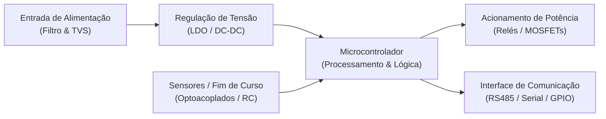

# Placa de Fechamento — Hardware & PCB Design

[](https://www.kicad.org/)
[-blue.svg)](https://jlcpcb.com/)
[](#-garantia-de-qualidade-e-validação)
[-blueviolet.svg)](#-padrão-de-commits-em-pt-br)
[]()

Repositório de engenharia de hardware e layout de circuito impresso (PCB) da **Placa de Fechamento**. O projeto adota arquitetura modular para controle, monitoramento de sensores e acionamento de potência com foco em imunidade a ruídos industriais e montagem automatizada na **JLCPCB (2 Camadas, 1 oz Cu, FR-4 1.6 mm)**.

---

## 🧭 Sumário Executivo

- **Ambiente CAD:** KiCad 10.0.5 integrado com KiCad MCP Server.
- **Topologia de Cobre:** 2 camadas com plano de terra contínuo e ininterrupto na camada inferior (`B.Cu`).
- **Filosofia de Proteção:** Proteção contra transientes (ESD/Surto) com diodos TVS *in-line flow-through* na entrada dos conectores.
- **Eficiência de Montagem (DFA):** Prioridade absoluta para componentes da categoria *Basic Parts* do catálogo LCSC/JLCPCB, eliminando custos adicionais de troca de carretel ($3.00/linha).
- **Rastreabilidade:** Todas as decisões críticas são registradas formalmente em [Hardware ADRs](.agents/adr/).

---

## 📐 Inspeção Visual do Circuito (Pré-visualizações Vetoriais)

Os arquivos gráficos do circuito são gerados automaticamente via script headless (`kicad-cli`) e podem ser inspecionados diretamente no navegador:

| Artefato | Arquivo Vetorial SVG | Formato | Finalidade |
| :--- | :--- | :--- | :--- |
| **Esquemático Elétrico** | [schematic/placa_fechamento.svg](docs/previews/schematic/placa_fechamento.svg) | Vetorial SVG | Leitura de conexões, blocos e designadores |
| **PCB — Camada Superior** | [pcb_top.svg](docs/previews/pcb_top.svg) | Vetorial SVG | Cobre `F.Cu`, Serigrafia e Máscara Superior |
| **PCB — Camada Inferior** | [pcb_bottom.svg](docs/previews/pcb_bottom.svg) | Vetorial SVG | Plano `B.Cu` e plano de terra contínuo |



---

## ⚙️ Especificações de Engenharia e DFM (JLCPCB 2 Camadas)

Todas as regras de design no KiCad seguem rigorosamente a tabela de valores recomendados de projeto (*Safe Production Values*):

| Parâmetro de Fabricação | Limite Máximo JLCPCB | Valor Adotado no Projeto | Observações de Engenharia |
| :--- | :--- | :--- | :--- |
| **Camadas de Cobre** | 2 camadas | **2 camadas (F.Cu / B.Cu)** | FR-4 padrão, espessura total 1.6 mm. |
| **Peso do Cobre** | 1 oz (35 µm) | **1 oz (35 µm Cu)** | Base para cálculo térmico IPC-2152. |
| **Largura de Trilha (Sinais)** | 0.10 mm (4 mil) | **0.15 mm a 0.20 mm** | Previne sobrecorrosão química e garante alto rendimento. |
| **Largura de Trilha (Alimentação Lógica)** | 0.10 mm | **0.50 mm** (20 mil) | Queda de tensão controlada para linhas $\le 500\text{ mA}$. |
| **Largura de Trilha (Potência)** | - | **1.00 mm a 1.50 mm** | Dimensionamento para correntes entre 1.0A e 2.0A ($\Delta T \le 10^\circ\text{C}$). |
| **Espaçamento Mínimo (Clearance)** | 0.10 mm (4 mil) | **0.15 mm** / **0.20 mm** | Cobre-cobre, pad-trilha e pad-pad. |
| **Distância Cobre à Borda** | 0.20 mm | **0.40 mm a 0.50 mm** | Previne exposição de condutores no corte da placa (V-cut/fresa). |
| **Furo Mínimo de Via (Drill)** | 0.15 mm | **0.30 mm** (12 mil) | Broca padrão de custo básico. |
| **Diâmetro do Pad da Via** | Drill + 0.26 mm | **0.60 mm** (24 mil) | Garante anel anular de 0.15 mm sem rompimento (*breakout*). |
| **Via de Potência (Individual)** | - | **Furo 0.40 mm / Pad 0.80 mm** | Suporta ~1.5A contínuos por via; usar matrizes em paralelo. |
| **Barragem de Máscara (Dam)** | 0.08 mm | **0.10 mm** | Impede pontes de solda entre pads adjacentes. |
| **Abertura de Máscara (Expansion)** | 0.00 mm | **0.05 mm** (2 mil) | Expansão uniforme ao redor dos pads de solda. |
| **Fiducials Globais** | - | **3 pontos de alinhamento** | Pad 1.0 mm / Máscara 2.0 mm a $\ge 3.5\text{ mm}$ das bordas. |

> [!NOTE]
> Para o manual completo de parâmetros e regras de alta frequência/EMC, consulte o documento [GEMINI.md](file:///C:/Projetos_PCB/Novo_Projeto/GEMINI.md).

---

## 🗂️ Estrutura do Repositório

```text
├── .agents/                        # Infraestrutura, regras, scripts e governança autônoma
│   ├── adr/                        # Architecture Decision Records de Hardware (.md)
│   ├── rules/                      # Regras ativas de comunicação e economia de tokens
│   ├── scripts/                    # Automações locais (diagnóstico, checkpoints, previews)
│   │   ├── check_env.ps1           # Script de autodiagnóstico de dependências
│   │   ├── circuit_checkpoint.py   # Utilitário de commit semântico e rollback automático
│   │   ├── generate_previews.py    # Gerador de visualizações vetoriais SVG (kicad-cli)
│   │   └── security_gate.py        # Hook de segurança de pré-execução de comandos
│   └── skills/                     # 17 skills modulares sob demanda (Progressive Disclosure)
├── docs/                           # Documentação complementar de hardware
│   └── previews/                   # Saídas gráficas atualizadas da PCB e Esquemático
├── fabrication/                    # Pacote homologado para fabricação (Gerbers, BOM, CPL)
│   ├── assembly/                   # Lista de materiais (BOM) e centroides (Pick & Place)
│   ├── gerbers/                    # Arquivos Gerber RS-274X e brocas Excellon
│   └── pdf/                        # Documentação técnica em formato PDF
├── libraries/                      # Bibliotecas locais de símbolos, footprints e modelos 3D
├── .gitignore                      # Filtro estrito de artefatos temporários do KiCad
├── .gitmessage.txt                 # Template oficial de commits padronizados em pt-BR
├── AGENTS.md                       # Protocolo de operação do assistente de engenharia
├── GEMINI.md                       # Especificações DFM e parâmetros numéricos de net classes
├── PROJECT_MEMORY.md               # Memória persistente viva do estado do circuito
├── README.md                       # Visão geral e documentação principal do projeto
├── diagnostico.bat                 # Atalho de autodiagnóstico do ambiente em um clique
├── iniciar.bat                     # Atalho de inicialização do assistente no repositório
├── placa_fechamento.kicad_pcb      # Layout da placa de circuito impresso no KiCad 10
├── placa_fechamento.kicad_pro      # Arquivo mestre do projeto KiCad 10
└── placa_fechamento.kicad_sch      # Esquemático elétrico mestre no KiCad 10
```

---

## 🛠️ Automações e Ferramentas Integradas

O repositório conta com ferramentas de apoio prontas para uso local:

| Ferramenta | Comando / Atalho | Função |
| :--- | :--- | :--- |
| **Inicialização do Assistente** | `iniciar.bat` | Conecta o ambiente do projeto e retoma a sessão ativa. |
| **Autodiagnóstico do Ambiente** | `diagnostico.bat` | Valida em 2s: KiCad CLI 10, venv Python, banco JLCPCB (513k peças), Java 25, FreeRouting e Git. |
| **Geração de Previews SVG** | `python .agents/scripts/generate_previews.py` | Renderiza esquemático e PCB em formato vetorial com timeout rígido de 15s. |
| **Checkpoints & Auto-Rollback** | `python .agents/scripts/circuit_checkpoint.py` | Salva commits padronizados em pt-BR ou reverte alterações em caso de falha no DRC. |

---

## 🧠 Catálogo de Skills Ativas (`.agents/skills/`)

O assistente opera sob uma arquitetura de **divulgação progressiva** (*Progressive Disclosure*), carregando as instruções detalhadas apenas quando a etapa correspondente é acionada:

1. **Hardware & KiCad:**
   - [`kicad10-pcb-designer`](.agents/skills/kicad10-pcb-designer/SKILL.md) — Heurísticas de layout, net classes e receitas de ferramentas MCP.
   - [`kicad-regime-classifier`](.agents/skills/kicad-regime-classifier/SKILL.md) — Classificação física de trilhas (IPC-2152, alta velocidade, analógico e potência).
   - [`embedded-pinout-planner`](.agents/skills/embedded-pinout-planner/SKILL.md) — Validação de funções alternativas de MCU e prevenção de conflitos de pinagem.
   - [`bom-lifecycle-auditor`](.agents/skills/bom-lifecycle-auditor/SKILL.md) — Auditoria de ciclo de vida e estoque real na base SQLite local de 513k peças da JLCPCB.
2. **Qualidade & Diagnóstico:**
   - [`systematic-debugging`](.agents/skills/systematic-debugging/SKILL.md) — Investigação metódica em 4 fases (5 Porquês) para falhas de DRC/ERC.
   - [`evidence-backed-verification`](.agents/skills/evidence-backed-verification/SKILL.md) — Comprovação empírica obrigatória (0 erros no ERC, 0 violações no DRC e SVGs).
   - [`systematic-code-reviewer`](.agents/skills/systematic-code-reviewer/SKILL.md) — Auto-auditoria crítica adversarial para scripts e modificações.
   - [`tdd-cycle-orchestrator`](.agents/skills/tdd-cycle-orchestrator/SKILL.md) — Ciclo Red-Green-Refactor para código e automações.
3. **Governança & Rastreabilidade:**
   - [`project-architect`](.agents/skills/project-architect/SKILL.md) — Planejamento formal guiado por especificação técnica (`SPEC.md`).
   - [`hardware-adr`](.agents/skills/hardware-adr/SKILL.md) — Registros formais de decisões de arquitetura de hardware em `.agents/adr/`.
   - [`git-hygiene-and-secrets`](.agents/skills/git-hygiene-and-secrets/SKILL.md) — Prevenção de vazamento de credenciais e filtragem de arquivos temporários do KiCad.
   - [`task-decomposition-and-tracking`](.agents/skills/task-decomposition-and-tracking/SKILL.md) — Checklist dinâmico persistente para tarefas complexas.
   - [`shell-safety-and-guardrails`](.agents/skills/shell-safety-and-guardrails/SKILL.md) — Execução estritamente não-interativa (headless) com timeouts.
   - [`secret-sanitizer-and-privacy`](.agents/skills/secret-sanitizer-and-privacy/SKILL.md) — Mascaramento de dados privados e tokens em tempo de execução.
   - [`subagent-orchestrator-mapreduce`](.agents/skills/subagent-orchestrator-mapreduce/SKILL.md) — Delegação para subagentes efêmeros rápidos sem saturação de contexto.
   - [`agent-memory`](.agents/skills/agent-memory/SKILL.md) — Memória viva contínua em `PROJECT_MEMORY.md`.
   - [`token-optimization`](.agents/skills/token-optimization/SKILL.md) — Economia de tokens e supressão de ruídos de ferramentas.

---

## 📌 Padrão de Commits em pt-BR

Todas as contribuições e checkpoints do projeto seguem obrigatoriamente a especificação **Conventional Commits em português do Brasil (`pt-BR`)**:

```text
<tipo>(<escopo opcional>): <descrição no imperativo e sem ponto final>
```

- **Tipos Permitidos:** `feat`, `fix`, `docs`, `style`, `refactor`, `perf`, `test`, `build`, `ci`, `chore`.
- **Exemplos Válidos:**
  - `feat(fonte): adicionar regulador LDO 3.3V com capacitores de desacoplamento`
  - `fix(drc): corrigir folga insuficiente entre trilhas de alimentacao`
  - `docs(readme): reestruturar documentacao do repositorio com tabelas e badges`

---

## 🚀 Como Iniciar

1. **Clonar o Repositório:**
   ```bash
   git clone https://github.com/kauan-barcellos/placa_fechamento.git
   cd placa_fechamento
   ```
2. **Executar o Autodiagnóstico:**
   - Dê um clique duplo em `diagnostico.bat` ou execute no PowerShell:
     ```powershell
     powershell -ExecutionPolicy Bypass -File .agents/scripts/check_env.ps1
     ```
3. **Iniciar a Sessão do Assistente:**
   - Dê um clique duplo em `iniciar.bat`.
